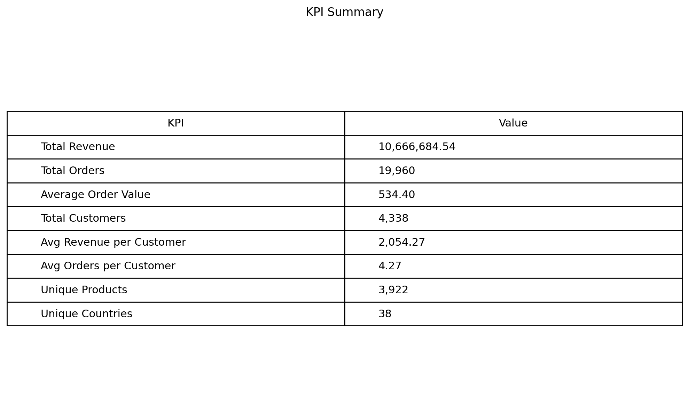
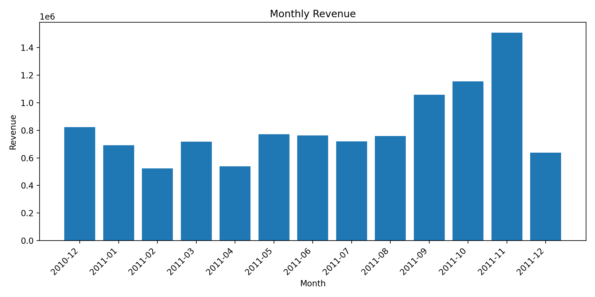
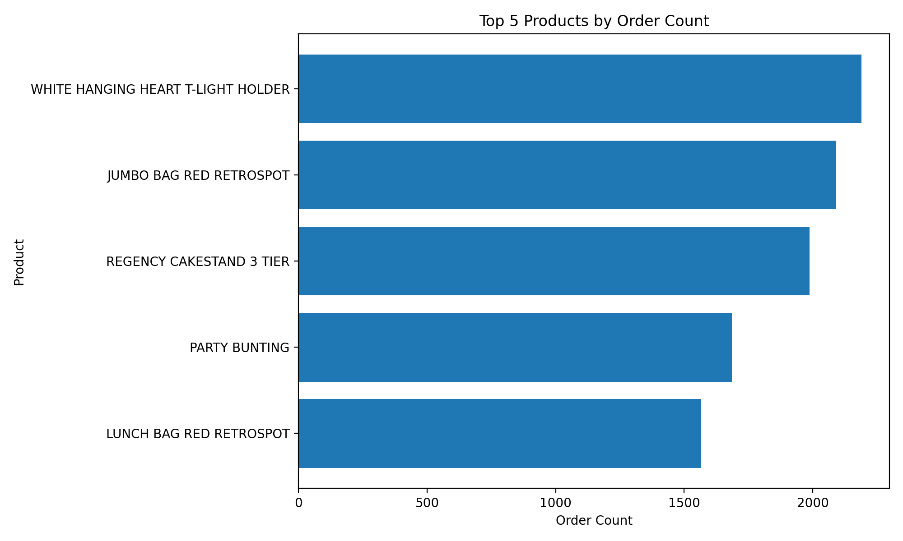
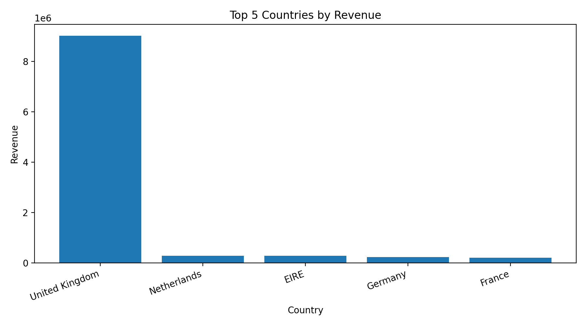
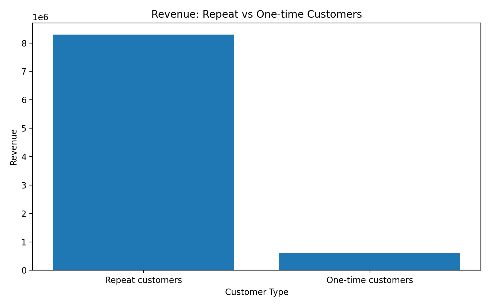

# SQL Online Retail Performance Analysis

## Overview
This project analyzes online retail transactional data in SQL to identify revenue patterns, customer behavior, product demand, and geographic concentration.

## Business Question
Which customers, products, and markets contribute most to commercial performance, and what business insights can be derived from transactional data?

## Dataset
Source: UCI Machine Learning Repository — Online Retail dataset. 

The dataset includes:
- invoice number
- product code and description
- quantity
- invoice date
- unit price
- customer ID
- country

## Tools
- SQL (PostgreSQL)
- DBeaver
- Git & GitHub
- CSV dataset

## Project Structure
- `data/raw/online_retail.csv`
- `sql/01_create_table.sql`
- `sql/02_data_quality_checks.sql`
- `sql/03_data_cleaning.sql`
- `sql/04_revenue_analysis.sql`
- `sql/05_product_analysis.sql`
- `sql/06_customer_analysis.sql`
- `sql/07_country_analysis.sql`
- `sql/08_repeat_customer_analysis.sql`
- `sql/09_business_kpis.sql`
- `images/`
- `results/`

## Data Cleaning
The raw dataset contained **541,909** rows.

After removing cancelled invoices, non-positive quantities, non-positive prices, and rows with missing or blank product descriptions, the cleaned dataset contained **530,100** rows.

## Visualizations

To complement the SQL analysis, I used Python to create a small set of supporting charts based on the same cleaned dataset logic.  
These visuals help illustrate the main findings more clearly and make the business patterns easier to interpret.

## Business KPIs
- **Total revenue:** 10,666,684.54
- **Total orders:** 19,960
- **Average order value:** 534.40
- **Total customers (known IDs):** 4,338
- **Average revenue per customer:** 2,054.27
- **Average orders per customer:** 4.27
- **Unique products:** 3,921
- **Unique countries:** 38

## Revenue Insights
Revenue peaked in the final quarter of 2011.

Top revenue months:
- **November 2011:** 1,509,496.33
- **October 2011:** 1,154,979.30
- **September 2011:** 1,058,590.17

## Product Insights
Top products by number of orders:
- **WHITE HANGING HEART T-LIGHT HOLDER** — 2,189
- **JUMBO BAG RED RETROSPOT** — 2,089
- **REGENCY CAKESTAND 3 TIER** — 1,988
- **PARTY BUNTING** — 1,685
- **LUNCH BAG RED RETROSPOT** — 1,564

## Customer Insights
The cleaned dataset included **4,338** customers with known IDs.

- **Average revenue per customer:** 2,054.27
- **Average orders per customer:** 4.27

Top 3 customers by revenue:
- **14646.0** — 280,206.02
- **18102.0** — 259,657.30
- **17450.0** — 194,550.79

## Geographic Insights
Top 5 countries by revenue:
- **United Kingdom** — 9,025,222.08
- **Netherlands** — 285,446.34
- **EIRE** — 283,453.96
- **Germany** — 228,867.14
- **France** — 209,715.11

Top 5 countries by number of orders:
- **United Kingdom** — 18,019
- **Germany** — 457
- **France** — 392
- **EIRE** — 288
- **Belgium** — 98

## Repeat Purchase Insights
Customer distribution:
- **Repeat customers:** 2,845
- **One-time customers:** 1,493

Revenue contribution:
- **Repeat customers:** 8,295,096.17
- **One-time customers:** 616,311.73

## Key Findings
- Revenue was strongly seasonal, with the highest results in Sep-Nov 2011.
- The United Kingdom dominated revenue, order count, and customer count.
- Repeat customers were the main revenue driver.
- Revenue and demand were concentrated among a limited set of customers and products.

## Recommendations
- prioritize retention strategies
- monitor UK market concentration risk
- focus on top recurring products
- prepare promotions and operations ahead of Q4 peaks
- extend the project with cohort or RFM analysis

## Author
**Larysa Yanushchyk**  
Data Analyst | Product & Business Analytics | SQL · Python · Tableau

